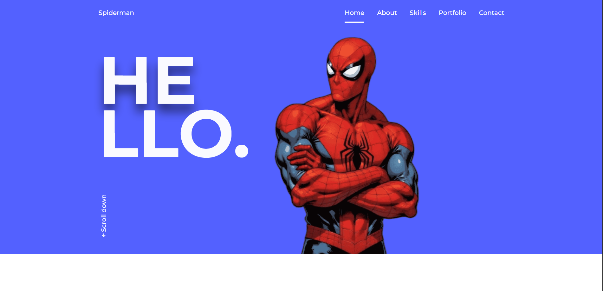

# Responsive Personal Portfolio Website



## Quick start

```bash
git clone https://github.com/kharalnirmal/FreePortfolio.git
cd FreePortfolio
npx serve .
```

Open the local URL printed in the terminal.

## Features

- Responsive Personal Portfolio Website Using HTML CSS And JavaScript
- Contains animations when scrolling.
- Smooth scrolling in each section.
- Developed first with the Mobile First methodology, then for desktop.
- Compatible with all mobile devices and with a beautiful and pleasant user interface.
